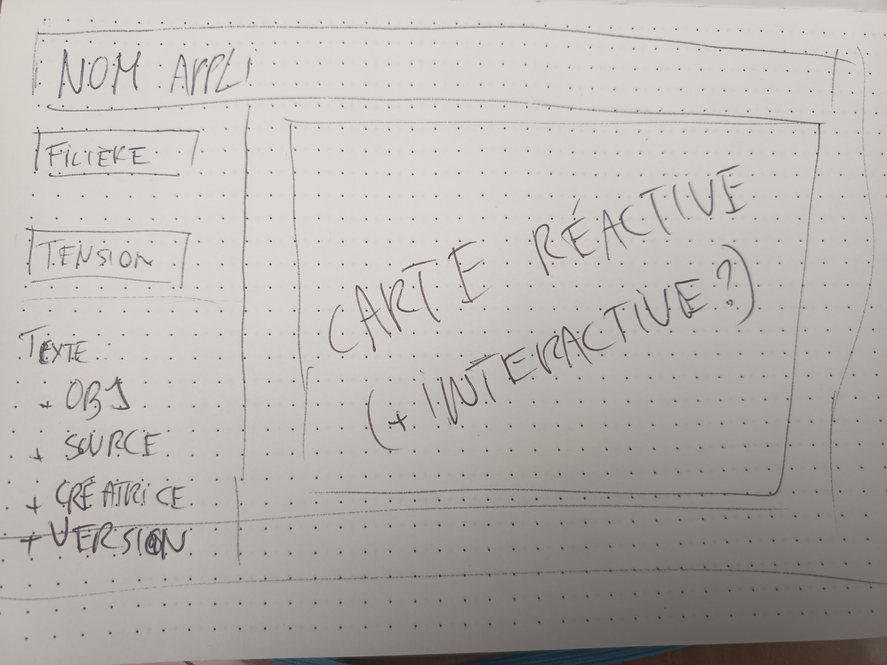

## Objectifs
Créer une appli `shiny` contenant une carte choroplèthe qui se mette à jour en fonction du choix de la personne utilisatrice.  
  

Dans ce support, tu retrouveras le code pour créer la carte.  
  
L'appli shiny est disponible dans le fichier [app.R](https://github.com/Vaugoyeau/twitch_choroplethe/blob/master/app.R)   

## Création de la carte  

Import des packages nécessaires :  

- `{tidyverse}`  
- `{maps}` doit-être installé sur ton ordinateur pour utiliser la fonction `map_data()` du package `{ggplot2}`  
  
```{r}
#| label: import_package
#| warning: false
#| echo: false

library(tidyverse)
```

Import et modification des données :  

- import via le [site de ODRE](https://odre.opendatasoft.com/assets/theme_image/logo-odre.svg) du fichier de données [Registre national des installations de production et de stockage d'électricité](https://odre.opendatasoft.com/explore/dataset/registre-national-installation-production-stockage-electricite-agrege/)  
- les données sont filtrées dans l'adresse pour n'avoir que des installations `en service`  
- seules les colonnes d'intérêts sont chargées : `region`, `filiere`, `tensionRaccordement`, `maxPuis`  
- les fonctions du packages `dplyr`sont utilisées pour générer un tableau résumé contenant la **puissance maximale cumulée** sur toutes les installations en fonction des modalités des colonnes `region`, `filiere` et `tensionRaccordement`  
  
```{r}
#| label: import_data

donnees_odre <- read_delim(
  "https://odre.opendatasoft.com/api/explore/v2.1/catalog/datasets/registre-national-installation-production-stockage-electricite-agrege/exports/csv?lang=fr&refine=regime%3A%22En%20service%22&facet=facet(name%3D%22regime%22%2C%20disjunctive%3Dtrue)&timezone=Europe%2FBerlin&use_labels=true&delimiter=%3B",
  col_select = c(region, filiere, tensionRaccordement, puisMaxInstallee)
) |> 
  drop_na(region) |> 
  group_by(
    region,
    filiere,
    tensionRaccordement
  ) |> 
  summarise(
    puissance_max_cumulee = sum(puisMaxInstallee)/1000
  ) |> 
  ungroup()

```

Création d'un fichier de fond de carte grâce à la fonction `map_data()` du package `{ggplot2}` (nécessite d'avoir le package `{maps}` présent).  

::: callout-note
Les régions présentes dans la table sont les départements et non les régions comme indiqués.  
Il faut donc concatener avec une table contenant la liste des départements par région.  
:::  
  
Puis jointure avec une table contenant les noms des départements et des régions de France sur le [site de `data gouv`](https://www.data.gouv.fr/datasets/departements-et-leurs-regions).  

  
```{r}
fond_de_carte <-
  map_data("france") |> 
  left_join(
    read_delim(
      "https://www.data.gouv.fr/api/1/datasets/r/987227fb-dcb2-429e-96af-8979f97c9c84"
    ) |> 
      mutate(
        nom_dept = dep_name |> 
          str_replace_all("[éèëê]", "e") |> 
          str_replace_all("[ôö]", "o") |> 
          str_replace("d'O", "Do") |> 
          str_replace("d'A", "Da") |> 
          str_replace("Corse-du-Sud", "Corse du Sud")
      ),
    by = join_by("region" == "nom_dept")
  ) |> 
  select(long, lat, group, region = region_name)
```

::: callout-tip
## `str_replace()` ou `str_replace_all()`  

Les fonctions `Str_replace()` et `str_replace_all()` du package `{stringr}` permettent de remplacer un `pattern` par une chaîne de remplacement.  

- `str_replace()` : ne le fait qu'une seule fois donc `str_replace("Pyrénées", "[éèëê]", "e")` donne `Pyrenées`    
- `str_replace_all()` : le fait autant de fois qu'il rencontre le `pattern` donc `str_replace_all("Pyrénées", "[éèëê]", "e")` donne `Pyrenees`  
:::  
  

## Jointure et représentation   
Choix de paramètres qui sera ensuite utilisés pour filtrer les données résumées  
```{r}
type_filiere <- "Solaire"
type_tension <- c("HTA", "BT")
```

Jointure du fond de carte avec la table filtrée pour ensuite représenter les données grâce à `{ggplot2}`  
```{r}
full_join(
  fond_de_carte,
  donnees_odre |> 
    filter(
      filiere == type_filiere,
      tensionRaccordement %in% type_tension
    ),
  by = join_by("region" == "region")
) |> 
  ggplot() +
  aes(
    x = long,
    y = lat,
    group = group,
    fill = puissance_max_cumulee
  ) +
  geom_polygon(color = "black") +
  labs(
    title = 
      paste("Tension de raccordement : ", type_tension |> str_c(collapse = ' / '), " \n Filière : ", type_filiere)
  ) +
  theme_void() +
  scale_fill_gradient(low = "pink", high = "darkblue")
```

